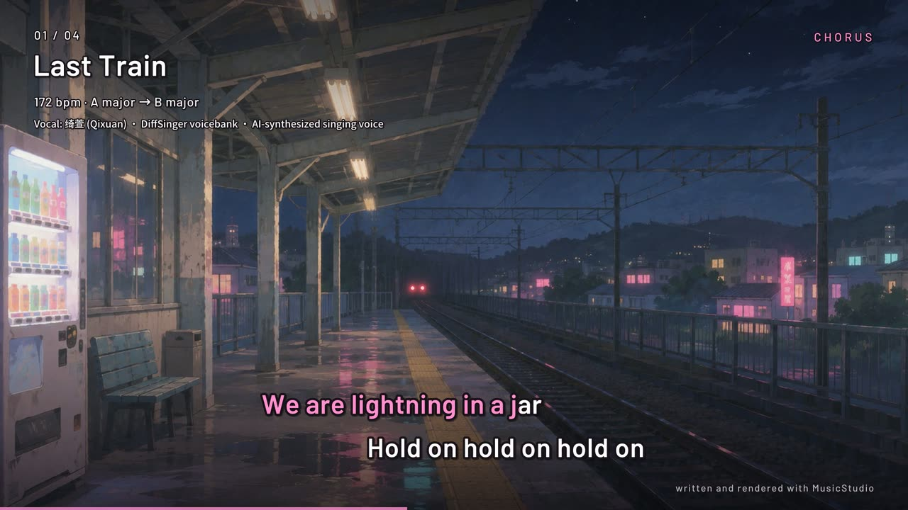

# MusicStudio

A music studio built for agents. Instrumental score writing — OST rather than
songs — where themes are objects you develop, not notes you retype.

[](https://github.com/unkarelian/MusicStudio/releases/download/demo-1/musicstudio_four_songs.mp4)

*Four pieces written and rendered with the studio — Last Train, Lanterns,
Undertow, Splinter ([video, 8:25, 87 MB](https://github.com/unkarelian/MusicStudio/releases/download/demo-1/musicstudio_four_songs.mp4);
[73-second teaser](https://github.com/unkarelian/MusicStudio/releases/download/demo-1/musicstudio_teaser.mp4)).
Vocal on "Last Train": 绮萱 (Qixuan), a DiffSinger voicebank — an AI-synthesized
singing voice ([SINGERS.md](SINGERS.md)). The backgrounds are generated images.*

## Why agents are bad at music

Not for lack of taste. Five specific mechanical reasons:

1. **They write blind.** A note stream is emitted token by token and never heard,
   never seen, never checked against anything.
2. **The abstraction is wrong.** MIDI note 67 at tick 1920 is the assembly
   language of music. Nobody thinks that; they think "the theme, a third higher,
   on the downbeat of bar 5".
3. **Time drifts.** One note the wrong length and everything after it slides,
   and nothing catches it.
4. **Nothing enforces harmony.** Lines wander off the chord, the bass note isn't
   in it, voices collide, and the register is wherever the tokens landed.
5. **Motifs don't survive.** An agent "brings the theme back" by re-emitting
   notes it half-remembers. The whole point of a leitmotif is *exact identity
   under transformation*, and approximate recall destroys precisely that.

MusicStudio removes all five as *possibilities* rather than coaching against them.

## How it works

**A piece is an op-log over a scaffold, not a note list.** A form, a harmonic
scaffold, and voices holding ordered, named operations:

```python
add_motif("hero", "0 2 4:1/4 3 2:1/2")
add_op("horn", "play",   id="statement", motif="hero", at="5")
add_op("horn", "play",   id="return",    motif="hero", at="33",
       transform=["invert", "augment:2"])
add_op("cello", "bass",  id="ground",    at="1", bars=48, pattern="root")
```

Ops are addressable, so revision is surgical — `update_op("return", transpose=2)`
moves one statement of a theme and leaves the rest of the score alone.

**Every change is a checkpoint.** Mutations autosave, and the state before each
save goes onto a per-piece undo stack (`<project>/.history/`, 100 deep). Trying
the bold version of an idea is free when taking it back is `ms undo dusk` —
which also answers with a diff of exactly which notes came back. Deleting a
piece is undoable too.

**Pitch is scale degrees, never MIDI numbers.** `"0 2 4:1/4 3 2:1/2"` is a
shape, not a set of notes; it becomes pitches only when a key and a chord say
so. Out-of-key notes are unrepresentable rather than discouraged, modulation is
a one-line change, and the classical development operations become exact integer
arithmetic instead of approximations:

```
transpose   deg + n            inversion   2*axis - deg
retrograde  reverse the steps  augment     durations * factor
```

**Harmony is roman numerals, and chords stack thirds in the scale.** So `ii` is
minor in a major key without being told, `V7` gets a minor seventh, and `vii%7`
comes out half-diminished — the spellings agents reliably get wrong from memory.

**Motifs are named objects with recorded lineage.** This is the whole point.
Because `hero.invert.augment` is derived rather than retyped, the studio can
*state* — not guess — that the theme returning in the last act is the same
theme, and show you where every statement of it lands:

```
  motif            form                   appearances (bar: voice)
  hero             as written             5:horn 13:horn
  hero             invert:0               33:cello
  hero             fragment:0,3+sequence  21:violin 23:violin 25:violin
```

**A theme can be as ornate as you can hear, and still be the theme.** A note
takes an ornament or an articulation as a mark, and long themes are built by
joining cells:

```python
add_motif("call",  "4:1/4. 2 4:1/4 7:1/4 | 7 6 5:1/4 3:1/4. 5")
add_motif("close", "8:1/4 7 5 #6:1/4.@tr 8 | 7:1/2. r:1/4")       # trill the leading tone
derive_motif("theme", "call", ["then:rise", "then:reply", "then:close"])
derive_motif("theme_sung", "theme", ["embellish:passing", "ornament:gr+1,4"])
```

`@tr @mord @lmord @turn @gr @run-3` are realized in degree space, so a trill is
whichever trill the key gives and survives a modulation; the written note keeps
its onset and its end, and graces borrow their time from the note before, so
decorating a line never moves it. The elaborating transforms — `embellish`
(written-out neighbours, turns and passing notes), `ornament`, `expand`, `dot`,
`displace`, `thin`, `mirror`, `append`, `then` — all record lineage like the
classical ones. The eight-bar, ornamented, re-rhythmed repeat is therefore
*provably* the tune it decorates, and the motif map says so.

**It is played, not sequenced.** Four things separate a performance from a
piano roll, and each is an op or a parameter rather than a hope:

- `chords` with `lead=True` moves to the nearest inversion instead of jumping
  in root position; `ring=True` is the sustain pedal (or a harp left to sound);
  `roll="1/32"` strums; `figure="0 1+2 1+2"` writes your own pattern in
  chord-tone indices, so it re-fits every chord.
- `shape` phrases a line: a swell toward each phrase's peak, a taper off its
  end, a lean on high notes and downbeats. `swing` delays the off-beats.
- `articulation="legato"` (or `@leg` on one note) slurs: the render glides into
  the next note instead of attacking it again.
- a section's `tempo_end` is a ritardando or accelerando, eased so most of it
  happens in the last bar, and shared by the WAV and MIDI exports.

**The studio knows what instruments can do.** A voice is an instrument with a
range, a register where it actually sounds like itself, and a polyphony limit.
Ask a horn for a low E and it is an error; write a melody without naming an
octave and it lands where a horn sounds heroic rather than where the tokens fell.

## The views

Every mutation returns one. `score` is a pitch-by-time grid, one glyph per
voice, every column labelled by bar — which is what makes counterpoint *visible*:

```
    bar 1       2       3       4
        |       |       |       |
     A4|  Ll                    Pppppppp
     F4| L   Lll                Pppppppp
     D4|Lppppppp        Pppppppp
     D2|OoOoOoOo        OoOoOoOo
  chord|i       VI      iv      V7
```

`squint` is the arc — one column per bar, four lines, the whole piece:

```
  density  ..::-=+*##%@%#*+=-::..
  register __..--~~^^^~~--..__
  dynamic  ...:::---===+++***##
  voices   1122334455554433221
           intro   build   climax  resolve
```

If those lines are flat, the piece is flat, and no amount of good writing inside
the bars will fix it. `chart` shows the form and harmony; `motif_map` answers
whether the themes are developing or just repeating.

`tension` is the arc `squint` cannot show: not how much is happening, but
whether it leans anywhere.

```
  home        : + -=::-*  -=::-*:.*::=:+% -=::-*  .--*     distance from the tonic
  dissonance      . ...- ... . ..: : :  ... ...=   .       sounding time off the chord
  surprise    @%:=+#=-#* *=+==**-+%##%#*#@+#=-#* +%-#* +   how unexpected the tune is
  tension    ::-=.--::-+.:==-==*==*=-+=+%-++==+#-.:--=.:   together with energy
             intrA       A2      B       climax  coda

  - the loud passage from bar 29 is prepared: the bar before it stands on a dominant
  - releases (a dominant or distant chord falling home): bar 5, 12, 23, 29, 36, 42
```

It is a model of tonal expectation — chord function, key distance, the
Krumhansl-Kessler key profiles, the preference for small intervals and for a
leap to be answered by a step — and says so on its first line. It describes;
it does not judge.

`hear` is the one view that reads the *sound*. It renders every voice alone and
measures the audio, because the first things a listener notices are in the
render and in no score view:

```
  loudness   :-+-=++++++=*****#**##**##*#%@@@@@%%=+==---   mix, A-weighted
  roughness  %=*=+=:=---*#*++++*+=::---==@*++++*%#=+==##   sensory dissonance
  tune       ..F.EEEEEEEEVVVVVVVVFFCCFFVVVVVVVVVVEEEEEE.   who carries it
  loudest    IIFIEEEEEEEEVVVVVVVVFFCCFFVVVFFFFFFFEEEEEEA   the loudest single voice
  clear        + +++++#++===+-=--#####+--=++++++=--+-+-    tune over everything else

  - the tune (violin) clears the rest by under 3 dB in bar 17, 19-20, 27-28;
    its loudest rival there is harp
```

plus a table of every voice's level in every section, and every note that did
not really sound: one whose own pitch, in its own time, is far below what that
voice's other notes give. `--soundfont` measures the sampled render instead,
which can disagree with the built-in one.

## The critique pass

`lint` reports bar positions, because "the voice leading is bad somewhere" is not
actionable:

- `range_violation` / `polyphony_exceeded` — notes the player does not have,
  chords on a monophonic instrument
- `out_of_tessitura` — a line written where the instrument sounds weak
- `low_interval_limit` — close intervals in the bass, which turn to mud
- `parallel_fifths` / `parallel_octaves` / `voice_crossing` — two parts that
  stopped being two parts
- `chord_clash` — a long dissonance that grinds and never resolves
- `harmonic_stasis` / `cadence_missing` / `redundant_accidental`
- `flat_dynamics` — four minutes at one level
- `motif_starvation` / `motif_never_developed` / `verbatim_repeat` — the failures
  of *form*, which are the ones agents actually make
- `never_rests` — players breathe, and a line that never stops stops being heard
- `melody_buried` — a pad or chord part sitting just above the tune, within an
  octave of it, for most of the time they share: the commonest scoring error,
  and one a line-against-line crossing check cannot see
- `untracked_quote` — a `phrase` that retypes a motif (or its inversion or
  retrograde) by hand, so the motif map cannot see the theme came back; the
  hint names the `play` op that would track it

Checks are tuned for **precision over recall**. A false positive on correct
writing costs more trust than a missed finding costs quality, so parallels are
only reported between genuinely independent monophonic lines, a clash must be
long *and* dissonant *and* unresolved, a leap has to exceed an octave, and a
"moment" shorter than a 32nd note — the overlap humanized timing makes where
one note's release meets the next attack — is not counted as a chord. A
textbook-correct four-part progression must lint clean — there is a test
asserting exactly that.

Game music that repeats can be marked as a loop (`--loop` on `new`, or
`ms piece dusk --loop`), and the cadence check stops asking it to end on the
tonic.

## Listening to music it did not write

The studio also reads existing music, so it can be pointed at a piece and asked
what it is made of. Imported material becomes an ordinary piece — every view,
the critique pass and every export work on it unchanged.

**MIDI is exact.** Every pitch and onset is stated in the file, so analysis of an
imported MIDI is as trustworthy as analysis of something the studio wrote.

**Audio is an estimate, and says so.** Pulling a melody out of a finished mix is
the MIREX melody-extraction problem — research-grade and genuinely hard. What
comes back is a monophonic guess produced by harmonic-summation salience and a
Viterbi track, carrying a `confidence` score that falls on the two known failure
modes: long stretches of one pitch (the tracker has locked onto a pad or bass)
and alternating intervals (it is flip-flopping between two partials).

```bash
uv run ms -p gallery import theme song.mid          # exact
uv run ms -p gallery import theme song.ogg          # estimated, with warnings
uv run ms -p gallery findmotifs theme
uv run ms -p gallery compare theme_a theme_b theme_c
uv run ms -p gallery adopt theme main --index 0     # make a find into a real motif
```

### Discovery refuses to guess

The hard part of finding themes is not finding repeated patterns — it is
declining to report the ones that mean nothing. Any long melody contains
thousands of repeated interval sequences by chance, and a scale passage hands you
`[2,2,2,2]` in every piece ever written. So:

- every candidate is tested against a **null model** — the same intervals,
  shuffled, many times over — and dropped if it appears about as often by chance;
- **degenerate shapes are refused outright**: all repeated notes, pure
  alternation, unbroken scale runs. These carry no thematic information, and not
  coincidentally they are also precisely what a failing pitch tracker emits;
- a cross-piece claim must clear significance **in every piece it is claimed to
  appear in**, and the report states the weakest transcription's confidence.

This is the critique pass's principle applied to analysis. A tool that tells you
two pieces share a leitmotif when they do not is worse than one that says it
cannot tell — and there is a test asserting that three unrelated random melodies
produce no shared theme.

## Styles

A profile is a set of *checkable properties*, not a vibe. `orchestral` is the
baseline: enforced ranges and tessitura, voice leading between every pair of
parts, the low-interval limit. Also ships `chamber`, `ambient` (harmonic stasis
is the idiom, so that check relaxes), `piano` (two hands, tenth span limit), `electronic` (beat-driven and loop-based:
no cadence or voice-leading rules, but the low end is still policed),
`chiptune` (four monophonic channels — chords have to be arpeggios) and
`freeform`. Each carries form presets, which do for structure what canvas
presets do for a sprite: `--form cue` gives you `intro / build / climax /
resolve` before a note exists.

## Beats

The same idea — an editable description, not a recording — applied to drums,
bass and sound, in the `electronic` style:

```python
add_voice("drums", "kit", role="percussion")          # or kit_808, kit_jazz ...
add_op("drums", "beat", at="1", bars=16, tune=4, lanes={
    "kick":  "x.x.......xx....|x.x.......x.....",
    "snare": "....x..o.o..x..o|....x..o.o...x.o",     # o is a ghost note
    "hat":   "xoxoxoxoxoxoxoxo"})
add_op("drums", "chop", **{"from": "4", "until": "5"}, slices=8,
       order="0 1 2 3 2 3 2*2 3*4")                    # retrigger, then a roll
```

A kit is one voice with a lane per drum. `chop` cuts whatever a voice plays into
slices and re-orders them — `3*2` retriggers, `3r` reverses, `3^5` pitches up,
`.` drops out — so a break is cut the way a sampler cuts one, except that it
stays an edit: change a lane and every cut follows. `tune` plays the kit faster
and higher, which is most of what makes a break sound like a break.

A roll can climb as it goes: `3*8^0>12` is eight retriggers rising an octave.

A lane can also be written as a **pattern** rather than a grid. Give `beat` a
`cycle` (bars per turn) and each lane says the shape of the bar:

```python
add("drums", "beat", at="1", bars=8, cycle=1, lanes={
    "kick":  "x(3,8)",                 # three hits spread over eight: the tresillo
    "snare": ". x . <x [x x]>",        # the last backbeat doubles every other bar
    "hat":   "x*8",                    # eight to the bar
    "open":  ". . . [. o?]",           # a ghosted open hat, sometimes
    "tom_hi": "<. . . [. . . x*4]>",   # a roll into every fourth bar
})
```

`x . x .` is four equal steps, `[x x]` divides a step, `x*4` is a roll inside
one, `x!3` repeats it, `x@3` makes it three times as long, `x(3,8)` is a
Euclidean rhythm, `<a b>` picks a different one each turn, `a | b` is whole
bars in turn, and `x?` plays half the time (seeded, so every render is the
same). `ms pattern "x(5,8) [x x]"` draws any of it on a grid.

Under it: `sub_bass` (nearly a sine, slides between slurred notes),
`reese_bass` (detuned saws under a filter), `electric_bass` and `upright_bass`.
`acid_bass` and `acid_square` are the bass-line machine: one oscillator through
a resonant filter that every note re-opens. Velocity is its cutoff knob — soft
is a round pluck, loud squelches, an accent (`!`) screams — so a build is a
`dynamics` op, and a note marked `@leg` slides into the next without re-opening
the filter (`examples/build_nightshade.py`).
And on any voice, ops that shape sound rather than notes: `filter` (a lowpass
or highpass sweep across a span — the build and the drop), `drive`, `compress`
(denser, not louder), `crush`, `eq` (a bell cut or boost: room for a voice),
`duck` (sidechain: this voice dips whenever another one plays, the pump of a
pad against a kick), `cut` (silence across a span) and `gain` (the fader, for
after the others have changed the level). These are audio-only: the built-in
render applies them, a MIDI file and a full SoundFont render cannot.

A piece can also have **stops** (`set_master(stops=[{"from": "32:3", "until":
"33", "keep": ["vox"]}])`): the whole band and the room's reverb tail cut dead
while the kept voices carry on, dry. And its own **room**
(`set_master(room={"decay": 0.7, "wet": 0.06})`) in place of the style's.

A modelled kit is clean; a break is not. `add_voice(..., engine="soundfont")`
plays that one voice from the installed SoundFont *inside* the built-in render:
real recorded drums, tuned up by being played faster (rendered slow, then sped
up, exactly as a break is), and then through the same compressor, drive and
filter as anything else. Without a SoundFont the voice falls back to its model,
so the piece still builds anywhere.

For the far end of this: `drive` takes `mode="clip"` or `"fold"` and amounts up
to 4, `noise_wall` is an instrument that is almost all noise, `chop`'s pitch
marks move pitched voices as well as drums (so the same order on every voice is
a stutter of the whole mix), and `ms master <piece> --clip 12` drives the
finished mix past full scale and cuts the tops off, on purpose.

`examples/build_undertow.py` is the worked example, and
`examples/build_splinter.py` the extreme one: 174 bpm, a generated cut on every
bar, and a clipped master.

## Singing

A voice with a `singer` instrument sings words, and the voice is synthesized
from nothing — no recordings:

```python
add_voice("vox", "singer", role="melody")
add_op("vox", "play", motif="ask", at="3")            # seven notes
add_op("vox", "lyrics", text="I am a line of num-bers")   # seven syllables
```

One syllable per note. Hyphenate a word across notes (`lan-terns`), `-` holds
the previous vowel over another note, `_` leaves a note on "ah". A line that is
all romaji is read as Japanese (`ka ze ga fu i te`); otherwise words are English
through the CMU Pronouncing Dictionary (`ms lyrics install`, 3.6 MB, pinned by
hash) with spelling rules as a fallback; `[s t r ey n jh]` gives the sounds
exactly. `ms lyrics "a line of words"` shows how a line divides before you set
it, and a mismatch between notes and syllables is a warning on the render.

The voice (`vocal.py`) is a formant synthesizer: a source that buzzes at the
pitch, shaped by resonances whose positions are the vowel, with consonants as
the moments the tract closes or hisses. What makes it sing rather than speak on
a pitch is timing and motion — opening consonants are sung *ahead* of the note
so the vowel lands on the beat, formants glide between shapes, pitch slides
into each note, and above the staff the first formant follows the pitch the way
a soprano's does. Four voices: `singer` (bright, pitch that steps and holds),
`singer_warm` (slides and vibrato), `singer_low`, `singer_breathy`.

It sounds like what it is: clear vowels, words you can follow if you know them,
unmistakably synthetic. `examples/build_first_words.py` is a verse and a chorus.

### A neural singer

For a voice that actually *sings*, give a singer a DiffSinger voicebank — models
trained on a person singing, the open counterpart of a Synthesizer V or Vocaloid
voice:

```bash
uv sync --extra neural
uv run ms singer show qixuan                       # read what its terms ask
uv run ms singer install qixuan --accept-terms     # 401 MB, once
```

```python
add_voice("vox", "singer", role="melody", bank="qixuan")
add_op("vox", "lyrics", text="I will wait for you by the riv-er in the morn-ing")
```

**No voicebank ships with the studio.** Each is somebody's voice under that
person's terms, so installing one is an explicit step that shows you the terms
first; [SINGERS.md](SINGERS.md) lists the ones this engine has been run with,
where they come from, and what each asks (credit, and for some, non-commercial
use only). A voice whose bank is not installed falls back to the synthesized
singer with a warning.

The studio still decides the notes, the syllables and where each vowel lands;
the voicebank decides consonant lengths, the pitch curve between and within the
notes, and the timbre (`neural.py`). Renders are seeded and reproducible, and a
rendered phrase is cached, so only what you changed is sung again. On the fast
song this was built against (172 bpm, `examples/build_last_train.py`) a speech
recogniser followed 85-91% of the words, and unprepared lines at moderate tempo
came back word for word.

The singer breathes before a line where the one before left room, each note is
brought back to its written pitch if the model drifted off it, and a `tone` op
leans on how the voice is held (`breath`, `firm`, `crisp`, `gender`). A lyric
stores how each of its words is pronounced, so a saved piece sings the same on
any machine; a word with two pronunciations ("lives") is flagged when you write
it, and `said={"lives": "l ay v z"}` on the lyrics op chooses.
`examples/build_press_start.py` is a three-minute song that uses all of it.

### A recorded voice

For a human timbre, give a singer a **voice bank**: a recorded voice that is
complete on its own, so that from then on you only arrange notes and words.

```bash
export OPENROUTER_API_KEY=...
uv run ms lyrics install                         # the pronouncing dictionary
uv run ms voicebank build sarah --words 2000     # once: about a dollar, 4 minutes
```

```python
add_voice("vox", "singer", role="melody", bank="sarah")
add_op("vox", "lyrics", text="I will wait for you by the riv-er in the morn-ing")
```

Building records two things with a text-to-speech voice (ElevenLabs v4 through
OpenRouter) and keeps them in `~/.cache/musicstudio/voicebank` — never in a
piece or a repository:

- **a vocabulary** — the commonest English words, each recorded whole. A word
  in it is sung from its own recording, with the joins inside it exactly as
  they were spoken;
- **a unit corpus** — 271 one-syllable words chosen so that every join between
  a consonant and a vowel they use is covered. Each is cut in two at the middle
  of its vowel ("cat" gives `k-ae` and `ae-t`), and any word that was *not*
  recorded is assembled from those halves. So there is nothing the bank cannot
  sing, and nothing more is ever fetched.

What you hear is the recording. Voiced sound is re-pitched by PSOLA — cut at
each closing of the vocal folds into two-period grains, which are laid down
again at the spacing of the sung note, so the pitch is the score's and the
vowel is the speaker's. Unvoiced sound is played in fixed grains, so a consonant
can be shortened to fit a fast note without changing its tone. The vowel of
every syllable still lands on the beat, a held note stretches the middle of the
vowel and leaves its opening and closing at spoken speed, and every syllable is
sung at the note's loudness rather than at speech's.

`ms voicebank check <piece>` renders the singer alone and has a speech
recogniser write down what it hears, scored against the lyric. It is the
studio's ear for words, and it is how this engine was built: the first version
assembled *every* word from units and scored 37% on a fast song; singing
recorded words whole, stretching whole vowels and never resampling consonants
took the same song to 85%. Without a bank the voice falls back to the
synthesized singer and says so. It sounds like speech set to pitch, because that
is what it is; a neural singer (above) is the better voice where one may be used.

### A UTAU voicebank

A UTAU voicebank is a folder of short recordings and an `oto.ini` that says
where each syllable is in them. If you have one, the studio sings from it:

```bash
uv run ms utau add teto ~/Downloads/TETO-tougou-110401.zip   # a folder or its .zip
uv run ms utau show teto        # what it holds, and where its author's terms are
```

```python
add_voice("vox", "singer_warm", role="melody", bank="utau:teto")
add_op("vox", "lyrics", text="sa ku ra sa ku ra ya yo i no so ra wa")
```

**The studio downloads no voicebank and lists none.** Each is a person's voice
under terms its author wrote (often: non-commercial use, no redistribution);
they are in the text files inside the bank, and `ms utau show` prints where.
`add` uses a folder where it is, or unpacks a `.zip` with its Japanese file
names intact -- a plain unzip on Linux or macOS usually turns them to noise.

It reads Japanese banks: kana or romaji aliases, separate syllables (CV) or
chained ones (VCV, used wherever the bank has them), and `prefix.map` for banks
recorded at several pitches. The preutterance point of each recording is put on
the beat, so consonants are sung ahead of the note, like every singer here. A
lyric in romaji maps straight onto the bank: on the one bank this was checked
against (Kasane Teto's free UTAU library, 1,244 recordings) a speech recogniser
wrote down 19 of 20 syllables of an unprepared line. English is sung through
the same Japanese syllables, so it has a Japanese accent and is only partly
understood (about half the words of a test line). Banks with English aliases
(arpasing, VCCV) are not read yet.

For a voice the studio cannot run at all -- a paid Synthesizer V or Vocaloid
voice lives inside its own editor -- `ms ust <piece> <voice>` writes the line
as a `.ust` file (notes, kana lyrics, tempo), which UTAU and OpenUtau open and
other singing editors import.

## Use it

```bash
uv sync --all-extras

uv run ms styles                      # the rules and form presets
uv run ms ops                         # the op vocabulary
uv run ms transforms                  # the development vocabulary
uv run ms instruments --family brass  # ranges and idiom

uv run ms -p gallery new dusk --key "d minor" --tempo 76 --form cue
uv run ms -p gallery harmony dusk 1=i 3=VI 5=iv 7=V7
uv run ms -p gallery voice dusk horn horn --role melody
uv run ms -p gallery motif dusk hero "0 2 4:1/4 3 2:1/2"
uv run ms -p gallery op dusk horn play --id h1 motif=hero at=5
uv run ms -p gallery show dusk --bars 5-8
uv run ms -p gallery squint dusk
uv run ms -p gallery motifs dusk
uv run ms -p gallery lint dusk        # exits non-zero on errors
uv run ms -p gallery wav dusk         # and actually listen to it
uv run ms -p gallery wav dusk --soundfont   # sampled instruments, if installed

uv run ms -p gallery undo dusk        # take back the last change (diff + lint)
uv run ms -p gallery redo dusk
uv run ms -p gallery piece dusk --key "e minor" --tempo 84   # transpose / retime
uv run ms -p gallery toggle dusk h1 off                      # A/B an op
```

Also: `setsection`, `setvoice` (incl. `pan=`), `rmsection`, `rmvoice`,
`rmmotif`, `reorder`, `delete`, `history`. `ms --help` lists everything.

As an MCP server:

```bash
uv run ms-mcp /path/to/project
```

or in `.mcp.json`:

```json
{"mcpServers": {"musicstudio": {"command": "uv",
  "args": ["run", "--directory", "/path/to/MusicStudio", "ms-mcp", "/path/to/project"]}}}
```

## Listening

`wav` renders a stereo 16-bit file. Three things are there because they are
what let an ear pick the parts apart — which is the whole reason to listen:

- **voices are seated** like an orchestra (violins left, low strings right,
  bass pulled to the centre), or wherever a voice's own `pan` puts them;
- **each voice is played through a model of its instrument**, not a fixed
  waveform under one envelope;
- **there is a room** sized to the style — long for ambient, short for chamber,
  nearly dry for chiptune — with early reflections, and less of the low
  instruments sent to it.

### Why it does not sound like a sound chip

One static oscillator per voice is an accurate model of a 1980s console and of
nothing else. A real instrument differs in a few specific ways, and `synth.py`
is those ways:

- **The spectrum moves.** A trumpet's upper partials arrive after the note
  speaks and leave first; a piano's die many times faster than its fundamental;
  everything is brighter played louder. A note is several band-limited tables
  crossfading over its life.
- **The body does not transpose.** A violin's wood and an oboe's bore resonate
  at fixed frequencies whatever note is played, so harmonics are shaped by
  formants at absolute pitch — which is most of what lets an ear say "oboe".
- **Onsets are noise.** Bow hair catching, breath before the tone, a hammer on
  a string.
- **Nothing is steady.** Vibrato arrives late and wavers, pitch drifts a few
  cents, a string section is several players who do not quite agree, and a
  slurred note glides out of the last one instead of being attacked.
- **Struck things are inharmonic.** Bells, bars and timpani are sums of
  partials at their own ratios and decays; piano strings stretch sharp; kick,
  snare, cymbals and taiko are each built as what they are rather than as one
  burst of noise.

The models, the room and the limiter need numpy (the `analysis` extra); without
it the render is dry and plainly synthetic but is the same piece — the models
change how a note sounds, never which notes there are. `--plain` turns the
models off, `--dry` the room, `--mono` the seating. Everything random is seeded
from the note itself, so a render is the same bytes on every run. Chip and
synth instruments keep their plain oscillators, because there that *is* the
instrument.

It is still synthesis. It sounds like instruments being played; it does not
sound like a recording of them.

### Sampled instruments

For recorded instruments, `--soundfont` renders the same performance through
[FluidSynth](https://www.fluidsynth.org) with a General MIDI SoundFont. One
command fetches a good one:

```bash
uv run ms soundfont install        # MuseScore General HQ, MIT, 73 MB, once
uv run ms -p gallery wav lanterns --soundfont
uv run ms soundfont                # which bank is in use, and what is installed
```

The bank goes to `~/.local/share/soundfonts` with its licence beside it, and is
picked up from there with no path. It is downloaded rather than shipped because
it is 86 MB of recordings that the built-in render does not need. The download
is pinned by SHA-256 and nothing is installed if it does not match; the HQ bank
comes from Debian's package of it, since MuseScore no longer serves it as a
file. `ms soundfont install standard` fetches the lighter 38 MB bank, and
`--url ... --sha256 ...` installs any other.

To use a bank you already have:

```bash
uv run ms -p gallery wav lanterns --soundfont ~/sf/FluidR3_GM.sf2
export MUSICSTUDIO_SOUNDFONT=~/sf/FluidR3_GM.sf2   # or set it once
```

Every bank records its instruments at its own levels, so a piece balanced on
one comes out with the tune buried on another. The first render through a bank
therefore measures it: each instrument plays a phrase soft and loud through the
bank and through the built-in models, and from then on (cached in `~/.cache`)
each is trimmed, and its velocities reshaped, so the bank balances the way the
models do. `ms hear <piece> --soundfont` shows the result.

It is the MIDI export played by a sampler — same notes, same tempo map, same
seating — so it needs FluidSynth on `PATH` and a bank; neither ships here.

## Dependencies

The core has none. MIDI is read and written to spec and audio is synthesized with
the standard library, for the same reason the geometry in a pixel studio is
hand-rolled: the formats are small, exactly specified, and the failure mode of
getting them slightly wrong is a file that opens but is subtly wrong.

Audio *import* is the exception — spectral analysis over minutes of samples is
not something to do in pure Python — so it lives behind an extra, which also
makes WAV rendering several times faster and adds the reverb:

```bash
uv sync --extra analysis    # numpy; audio import also needs ffmpeg on PATH
```

MIDI import, motif discovery and cross-piece comparison need neither.

Neural singers are a second extra, and the only part of the studio that runs
someone else's model:

```bash
uv sync --extra neural      # numpy, onnxruntime, pyyaml; the voicebank is separate
```

## Development

```bash
uv sync --all-extras
uv run pytest tests/ -q
uv run python examples/build_dusk.py     # the dogfood build; it must lint clean
uv run python examples/build_lanterns.py # the long one: a joined theme, ornaments,
                                         # led chords, phrasing, a ritardando
```

`CLAUDE.md` (mirrored as `AGENTS.md`) lists the invariants the design rests on;
read it before changing `render.py`, `lint.py` or `analyze.py`.

## License

MIT — see [LICENSE](LICENSE).
